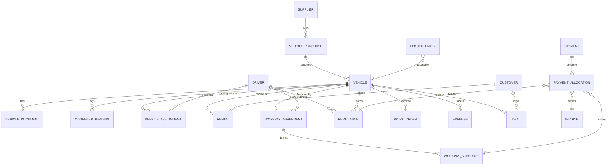

# 05 — Data Model & DB Conventions

> **Update 2026-10-13 (revision 2):** target is **PostgreSQL, one database per tenant** ([22](22_postgresql_architecture.md)). Read "collection" as "table"; embedded arrays become child tables or `jsonb`. Tenant tables do **not** carry a `tenant_id`. Conventions in §1 are replaced by [22 §3](22_postgresql_architecture.md) (uuid ids, `bigint` minor-unit money + currency, counters table, partial unique indexes, `CHECK` enums). §2 field lists stay as the functional baseline; §2.11 (control plane) becomes the `autoforce_platform` database plus billing tables from doc 25. §4 (data migration) is **not needed** — no data is carried over (decision 3). `Company` still becomes `organisation` + `branches`.

## 1. Conventions (apply to every tenant collection)

### 1.1 Base fields (via a shared Mongoose plugin replacing `withBaseSchema`)

```ts
{
  _id: ObjectId,
  code: string,              // human-readable number, e.g. "RT-2026-000123" (per-collection field name allowed)
  branchId?: ObjectId,       // replaces `company`
  createdAt: Date, updatedAt: Date,
  createdBy: ObjectId, updatedBy?: ObjectId,
  isDeleted: boolean, deletedAt?: Date, deletedBy?: ObjectId,
  version: number            // optimistic concurrency (Mongoose optimisticConcurrency: true)
}
```

Plugin responsibilities:
- Timestamps (use Mongoose's built-in, not hand-rolled defaults).
- Soft-delete filter on **all** query middleware: `find`, `findOne`, `findOneAndUpdate`, `countDocuments`, `aggregate`, `updateMany`… with an opt-out (`.setOptions({ withDeleted: true })`).
- `createdBy/updatedBy` filled from request context (AsyncLocalStorage holds `userId`).
- Optimistic concurrency to stop lost updates on balances.

### 1.2 Human-readable codes — atomic counters (fixes H15)

```ts
// collection: counters  { _id: "rental:2026", seq: 123 }
const { seq } = await Counters.findOneAndUpdate(
  { _id: `${key}:${year}` }, { $inc: { seq: 1 } }, { upsert: true, new: true, session });
code = format(settings.numbering.rental, { seq, year, branch }); // "RT-2026-000123"
```

- Formats configurable per tenant in `organisation.settings.numbering` (prefix, padding, yearly reset, branch prefix).
- Codes generated in the use-case (inside transaction), not in a pre-save hook.

### 1.3 Money (fixes float issues)

- Store as **integer minor units** (`amountMinor: 125050` = GHS 1,250.50) + `currency: "GHS"`.
- `Money` value object in `shared/kernel` handles add/subtract/allocate/round (banker's rounding for splits).
- Documents in a foreign currency also store `fxRate` and `amountBaseMinor` (tenant base currency) at transaction time.
- Alternative: `Decimal128` — workable but awkward in JS; minor units are simpler.
- Minor-unit size comes from the currency (GHS = 2 decimals, XOF = 0). Tenant base currency defaults to **GHS** and is user-selectable — see [20_currency_management.md](20_currency_management.md).

### 1.4 References

- One field per relation, named `<thing>Id` (`vehicleId`, `driverId`). Remove the duplicated `driver`/`driverId`, `vehicle`/`vehicleId`, `owner`/`ownerId`, `user`/`userId` pairs. Use Mongoose `populate` with `{ path: "vehicleId", as… }` or virtuals (`vehicle` virtual from `vehicleId`).
- **Snapshots** on financial documents: copy the bits that must not change later (customer name, plate number, rate) into the document — invoices must not change when a customer is renamed.

### 1.5 Enums

- Lower-snake-case string values, defined once in the domain (`VehicleStatus.AVAILABLE = "available"`), used by schema `enum` and zod.
- Run validators on updates (`runValidators: true`) — or better, update through domain methods.

### 1.6 History instead of embedded arrays

Drop unbounded arrays (`Vehicle.salesHistory`, `rentalHistory`, `maintenanceRecords`, `Driver.salesHistory`, `Customer.rentalHistory`). Query the owning collection by `vehicleId` / `customerId` with an index instead. Keep small bounded embeds (e.g. rental line items, check-in photos list).

### 1.7 Indexing baseline

Every collection: `{ isDeleted: 1, createdAt: -1 }`, `{ code: 1 } unique`, plus `branchId` compound where relevant. Per-module indexes listed below. Text search: Atlas Search index (preferred) or `$text` on name/plate/code fields; escape regex input otherwise.

---

## 2. Collection catalogue (tenant DB)

> ✱ = exists today (will be reshaped), ✚ = new

### 2.1 Core / identity

| Collection | Key fields | Notes |
|---|---|---|
| ✚ `organisation` | name, legalName, logoFileId, taxIds{tin, vat}, address, phone, email, baseCurrency (default `GHS`), enabledCurrencies[], timezone, fiscalYearStart, settings{numbering, rentals, workpay, remittances, approvals} | Singleton. Replaces ✱`Company` |
| ✚ `branches` | code, name, address, phone, managerId, isDefault | |
| ✱ `users` | firstName, lastName, email (unique, sparse), phone (unique, sparse), passwordHash, status(invited/active/disabled), roleIds[], branchIds[], scope, avatarFileId, lastLoginAt, mfa | Drivers *can* be users (for app login) |
| ✱ `roles` | name, description, permissions[], isSystem, permVersion | |
| ✱ `permissions` | key, module, description | Registry for UI only |
| ✚ `sessions` | userId, refreshTokenHash, device, ip, expiresAt, revokedAt | |
| ✱ `user_otps` | userId, purpose(verify/reset/login), codeHash, attempts, expiresAt (TTL index) | Hash the OTP; limit attempts |
| ✚ `invitations` | email/phone, roleIds, branchIds, tokenHash, expiresAt, acceptedAt | Replaces public register |
| ✚ `audit_logs` | actorId, action, entityType, entityId, before, after (diff), ip, requestId | TTL / archival policy |
| ✚ `files` | key, url, mime, size, kind, ownerType, ownerId, uploadedBy | |
| ✚ `counters` | _id key, seq | |
| ✚ `outbox` | eventId, type, payload, status, attempts, availableAt | |
| ✚ `notes` / `attachments` | polymorphic notes & comments on any entity | Activity timeline |

### 2.2 Parties

Option A (recommended): separate collections sharing a `Party` mixin (name, phones[], emails[], address, idDocuments[], tags, blacklisted). Option B: one `parties` collection with `roles: ["customer","driver","supplier"]`. A doc that becomes both a renter and a buyer is common → Option B is attractive; decide in doc 19.

| Collection | Key fields |
|---|---|
| ✱ `customers` | type(individual/corporate), name, phones, email(sparse unique), address, dob, occupation, idDocuments[{type: ghana_card/passport/dl, number, expiry, fileId}], driverLicence{number, class, expiry}, corporate{companyName, contactPerson, creditLimitMinor, paymentTermsDays}, riskStatus(ok/watch/blacklisted), blacklistReason, tags, source |
| ✱ `drivers` | userId?, firstName, lastName, phones, email(sparse), licence{number, class, issuedAt, expiry, fileId}, ghanaCard, guarantors[{name, phone, relationship, address, idFileId}], emergencyContact, status(active/inactive/suspended/terminated), hiredAt, terminatedAt, currentVehicleId (denormalised), employmentType(remittance/workpay/salary) |
| ✚ `suppliers` | name, type(dealer/auction/importer/individual/workshop/parts/fuel/insurer/clearing_agent), contacts, bankDetails, momoNumber, paymentTermsDays, taxId |

### 2.3 Vehicles (doc 06)

| Collection | Key fields | Indexes |
|---|---|---|
| ✱ `vehicles` | code, plateNumber, vin, engineNumber, make, model, trim, year, bodyType, colour, fuelType, transmission, seats, engineCC, mileageUnit, currentOdometer, status, usage(fleet/rental/workpay/stock/personal), ownership{type: owned/financed/leased/consigned/driver_owned, ownerPartyId}, acquisition{purchaseId, date, costMinor}, disposal{date, type, dealId, proceedsMinor}, branchId, currentAssignmentId, groupIds[], photos[fileId], specs{}, customFields{} | plateNumber unique (sparse — stock may lack plate), vin unique sparse, status, branchId+status |
| ✚ `vehicle_status_history` | vehicleId, from, to, reason, refType, refId, at, by | vehicleId+at |
| ✚ `vehicle_documents` | vehicleId, type(registration/roadworthy/insurance/income_tax_sticker/permit/customs/other), number, provider, issuedAt, expiresAt, costMinor, fileIds[], reminderDays[] | expiresAt, vehicleId+type |
| ✚ `vehicle_assignments` | vehicleId, driverId, type(remittance/workpay/salary/pool), startAt, endAt, startOdometer, endOdometer, terms{ targetMinor, frequency }, agreementId? | vehicleId+startAt, driverId+startAt; partial unique "one open assignment per vehicle" |
| ✚ `odometer_readings` | vehicleId, value, at, source(manual/rental/fuel/service/telematics), refId | vehicleId+at |
| ✚ `fuel_logs` | vehicleId, driverId?, litres, amountMinor, pricePerLitre, odometer, station, fullTank, receiptFileId, expenseId | vehicleId+at |
| ✚ `inspections` | vehicleId, type(pre_rental/post_rental/periodic/purchase), checklist[{item, ok, note, photoFileId}], fuelLevel, odometer, damages[{zone, type, severity, photoFileId}], signedBy, at | |
| ✚ `vehicle_groups` | name, rule? | |
| ✚ `telematics_positions` (time-series collection) | vehicleId, ts, lat, lng, speed, ignition, odometer | Mongo time-series, TTL |

### 2.4 Rentals (doc 07)

| Collection | Key fields |
|---|---|
| ✚ `rate_plans` | name, vehicleClass/vehicleIds, unit(hour/day/week/month), priceMinor, mileageIncluded/day, extraKmMinor, weekendPriceMinor, seasonal[{from,to,priceMinor}], depositMinor, lateFeePerHourMinor, chauffeurDailyMinor |
| ✚ `vehicle_classes` | name (Economy, SUV, Luxury, Bus), defaultRatePlanId |
| ✚ `rental_extras` | name, pricing(per_day/flat), priceMinor, stock? (child seat, GPS, chauffeur, delivery) |
| ✱ `rentals` (bookings) | code, customerId, driverMode(self/chauffeur), chauffeurDriverId?, vehicleClassId, vehicleId?, status(quote/reserved/confirmed/checked_out/returned/closed/cancelled/no_show), pickup{at, branchId, address}, return{at, branchId, address}, actualPickupAt, actualReturnAt, ratePlanSnapshot, lines[{type: base/extra/fee/discount/damage/fuel/excess_km/late, desc, qty, unitPriceMinor, totalMinor}], totals{subtotal, discount, tax, total, paid, balance, depositHeld}, depositStatus, checkoutInspectionId, checkinInspectionId, contractFileId, extensions[{from, to, amountMinor, by, at, note}], source, notes |
| ✚ `vehicle_blocks` | vehicleId, from, to, reason(rental/maintenance/sale_hold/other), refType, refId | **Overlap check index**: vehicleId+from+to |
| ✚ `damages` | vehicleId, rentalId?, reportedAt, zone, description, severity, photoFileIds[], repairCostMinor, chargedToCustomerMinor, status, workOrderId |

### 2.5 Work & Pay (doc 08)

| Collection | Key fields |
|---|---|
| ✱ `workpay_agreements` | code, driverId, vehicleId, guarantors[], vehicleValueMinor, markupType(multiplier/percent/flat), totalPayableMinor, depositMinor, frequency(daily/weekly/monthly), installmentMinor, termPeriods, startDate, firstDueDate, graceDays, penaltyRule{type, valueMinor/percent, capMinor}, status(draft/active/in_arrears/defaulted/restructured/completed/terminated/repossessed), totals{paid, outstanding, overdue, penalties}, ownershipTransferredAt, contractFileId, terminationReason |
| ✚ `workpay_schedule` | agreementId, seq, dueDate, amountMinor, paidMinor, status(upcoming/due/partially_paid/paid/overdue/waived), paidAt | agreementId+seq unique; dueDate+status |
| ✚ `workpay_penalties` | agreementId, scheduleId, amountMinor, reason, waivedBy?, at |
| ✱ `payment_records` → replaced by finance `payments` + `allocations` (doc 13) |

### 2.6 Remittances (today's "sales", doc 09)

| Collection | Key fields |
|---|---|
| ✱ `remittances` | code, driverId, vehicleId, assignmentId, periodStart, periodEnd, expectedMinor, declaredMinor, receivedMinor, shortfallMinor, status(pending/submitted/approved/rejected/partially_paid), paymentIds[], approvedBy, rejectionReason, tripsCount?, platformEarnings{uber, bolt, yango}? |
| ✚ `driver_ledger` (view or collection) | driverId, date, type(target/payment/shortfall/advance/deduction/bonus), amountMinor, refType, refId, runningBalanceMinor |

### 2.7 Purchasing & dealership (docs 10, 11)

| Collection | Key fields |
|---|---|
| ✚ `vehicle_purchases` | code, supplierId, type(local/import/auction/trade_in/consignment), status(draft/ordered/in_transit/at_port/clearing/received/cancelled), lines[{vehicle spec / vin, priceMinor, currency}], costs[{type: purchase/shipping/insurance/duty/clearing/port/transport/registration/other, amountMinor, currency, fxRate, supplierId}], landedCostMinor (computed), payments, documents{billOfLading, invoice, customsEntry}, eta, receivedAt |
| ✚ `reconditioning_jobs` | vehicleId, items[], costMinor, status → can reuse maintenance work orders with `purpose: "reconditioning"` |
| ✚ `stock_listings` | vehicleId, askingPriceMinor, minPriceMinor, status(draft/listed/reserved/sold/withdrawn), channels[website, jiji, tonaton, facebook], description, photos[], publishedAt |
| ✚ `leads` | name, phone, email, source, interestVehicleIds[], budget, stage(new/contacted/test_drive/negotiation/won/lost), assignedTo, nextFollowUpAt, lostReason |
| ✚ `test_drives` | leadId, vehicleId, at, licenceChecked, odometerOut/In, staffId |
| ✚ `quotes` | leadId/customerId, vehicleId, priceMinor, discounts, tradeIn{vehicle, valuationMinor}, financing, validUntil, status |
| ✚ `deals` (vehicle sales) | code, customerId, vehicleId, salespersonId, priceMinor, discountMinor, tradeInVehicleId?, tradeInValueMinor, depositMinor, financing{type: cash/bank/inhouse/workpay, provider, amountMinor}, status(draft/reserved/pending_payment/delivered/cancelled), deliveredAt, documents, commission{ruleId, amountMinor, paidAt}, grossProfitMinor (computed snapshot) |
| ✚ `commission_rules` | basis(percent_gross/percent_price/flat), value, tiers[] |

### 2.8 Maintenance & expenses (doc 12)

| Collection | Key fields |
|---|---|
| ✚ `service_plans` | name, appliesTo(vehicleIds / groups / make-model), tasks[{name, everyKm, everyDays, partsTemplate}] |
| ✚ `service_due` | vehicleId, planTaskId, dueAtKm, dueAtDate, status(upcoming/due/overdue/done) |
| ✚ `work_orders` | code, vehicleId, type(preventive/corrective/accident/reconditioning/inspection), status(open/in_progress/awaiting_parts/completed/cancelled), reportedBy, assignedTo / vendorId, odometer, lines[{type: labour/part/other, partId?, desc, qty, unitCostMinor}], totalMinor, startedAt, completedAt, downtimeHours, expenseIds[] |
| ✚ `parts` | sku, name, category, unit, reorderLevel, avgCostMinor |
| ✚ `part_stock_moves` | partId, type(in/out/adjust), qty, unitCostMinor, refType, refId, branchId |
| ✱ `expenses` | code, categoryId, amountMinor, currency, date, vehicleId?, driverId?, supplierId?, branchId, paymentMethod, paidFrom(cash/bank/momo/driver_deduction), status(draft/submitted/approved/rejected/paid), approvals[{by, at, decision, note}], receiptFileIds[], recurring{ruleId}, workOrderId?, purchaseId? |
| ✱ `expense_categories` | name, code, parentId, type(vehicle/overhead/staff/other), defaultLedgerAccount, isSystem |
| ✚ `budgets` | categoryId/vehicleId/branchId, period, amountMinor |
| ✚ `recurring_rules` | template, cron/frequency, nextRunAt |

### 2.9 Finance (doc 13)

| Collection | Key fields |
|---|---|
| ✚ `invoices` | code, partyType, partyId, sourceType(rental/deal/workpay/remittance/other), sourceId, lines, totals, dueDate, status(draft/issued/partially_paid/paid/void) |
| ✚ `payments` | code, direction(in/out), partyType, partyId, method(cash/momo/bank/card/cheque/offset), provider(paystack/hubtel/manual), providerRef, amountMinor, currency, receivedAt, receivedBy, branchId, status(pending/confirmed/failed/reversed), receiptFileId |
| ✚ `payment_allocations` | paymentId, targetType(invoice/schedule/remittance/rental/deal/expense/purchase), targetId, amountMinor |
| ✚ `ledger_entries` | date, account, debitMinor, creditMinor, refType, refId, vehicleId?, branchId?, partyId? | Enables vehicle P&L |
| ✚ `fx_rates` | base, quote, rate, date, source, enteredBy | doc 20 |
| ✚ `accounts` (chart) | code, name, type(asset/liability/income/expense/equity), isSystem |
| ✚ `cash_sessions` | branchId, openedBy, openingFloat, closedAt, expected vs counted |

### 2.10 Notifications & reports

| Collection | Key fields |
|---|---|
| ✚ `notifications` | userId/partyId, channel, template, payload, status, sentAt, error |
| ✚ `notification_rules` | event, conditions, channels, recipients, enabled |
| ✚ `report_jobs` | type, params, requestedBy, status, fileId, error |
| ✚ `daily_vehicle_stats` | vehicleId, date, revenueMinor by source, costMinor by category, km, utilisationHours, status minutes | Pre-aggregated read model |

### 2.11 Control plane (system DB)

`tenants`, `tenant_domains`, `clusters`, `plans`, `subscriptions`, `platform_invoices`, `platform_users`, `user_directory`, `migrations_state`, `platform_audit_logs`, `webhook_events` (idempotency for Paystack callbacks).

---

## 3. ER overview (core)



## 4. Migration of existing data (high level)

| From | To | Notes |
|---|---|---|
| `Company` | `organisation` + default `branch` | keep id as branch id |
| `*.company` | `*.branchId` | |
| `Vehicle.status` mixed case | normalised enum | map `Rented`→`on_rent`, `Sold`→`sold`, `in-use`→`assigned` … |
| `Vehicle.ownerId` | `ownership` | |
| embedded histories | drop (data already in source collections) | verify first |
| `Sale` | `remittances` | rename + money to minor units |
| `Rental.amountPaid/balance` | `payments` + `allocations` (opening balance payment) | |
| `WorkAndPayAgreement` + `PaymentRecord` | `workpay_agreements` + generated `workpay_schedule` + `payments` + allocations | regenerate schedule from startDate, allocate historic payments oldest-first |
| `Expense` | expenses v2 (minor units, approvals[]) | |
| all codes | seed `counters` with current max | |
